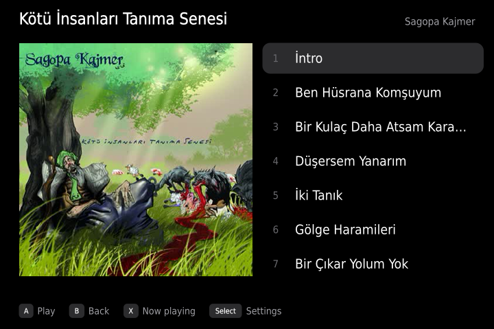
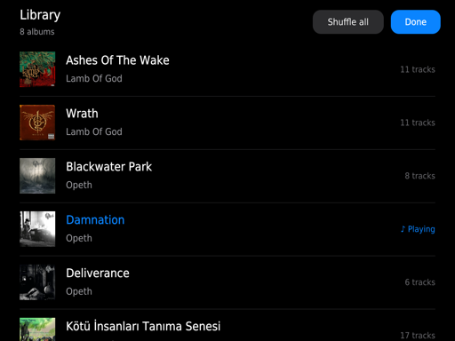

<h1>CMP</h1>

**Console Music Player: a music player for retro handhelds that you actually want to use.** 
Cover Flow, your albums and covers, resume where you stopped, and music that keeps playing under a game.

**[Download](https://github.com/cobanov/cmp/releases/latest)** · [Install](#try-it) · [Controls](#controls) · [Changes](CHANGELOG.md) · [Issues](https://github.com/cobanov/cmp/issues)

CMP replaces the music players that ship with handheld firmwares, which were never made for a small screen and a pad. It runs on [ROCKNIX](https://rocknix.org) today and is built on the mpv that ROCKNIX already includes, with Lua scripts and one small Python helper. There is nothing to compile. It fits any screen size, from 640x480 to the 1024x768 screens of the Anbernic RG DS Plus, and uses the second screen of dual-screen devices.

  
  
   Cover Flow and the player on an Anbernic RG SP (720x480).
    
  
  
   An album and the settings: big type, made for a pad.
    
  
  
   On a dual-screen device the music keeps playing on the second screen during a game, with its own touch library.

## Made for the device in your hands

- **Your library as it is.** Any folder with music is an album, at any depth: `Artist - Album`, `Artist/Album`, `Artist/Album/CD1`. Folders without a clear name are named from their tags, loose tracks become "Singles".
- **Covers without a computer.** Pictures come from `cover.jpg`, `folder.jpg` or the picture inside the track, are made on the device the first time and kept in a cache.
- **Cover Flow, a list, and a real player.** Browse with Cover Flow or a list, open an album, and the player shows the cover, the controls, the progress and what comes next.
- **One meaning per button.** A chooses, B goes back, X jumps to the player, L1 R1 change the track, L2 R2 seek. The hints at the bottom always show the buttons in the same order.
- **Picks up where you left it.** The queue, the track and the position are saved when you quit.
- **Music under your games.** On dual-screen devices, L1 + R1 (or "Play in background") moves the queue to the second screen, where it keeps playing with touch controls while you play on the main one.

## Controls

| Button | What it does |
|---|---|
| A | Choose: open the album, play a track, press the focused control |
| B | Back |
| X | Now playing |
| ↑ ↓ | Move; in the player, between the controls, the progress bar and the queue |
| ← → | Browse; in the player, walk the controls or seek on the progress bar |
| L1 R1 | Previous / next track |
| L1 + R1 | Play in the background (two screens) |
| L2 R2 | Back / forward 10 s |
| Select | Settings |
| Start | Quit, the queue is saved |

## Try it

1. Put your music under `/storage/roms/music`, in any folder layout.
2. Download `cmp-<version>.tar.gz` from the [latest release](https://github.com/cobanov/cmp/releases/latest) and unpack it.
3. From a computer on the same network: `./install.sh --music root@<handheld-ip>` (SSH can be turned on in ROCKNIX's network settings; the root password is `rocknix` unless you changed it).
4. In EmulationStation, open the Music Player system and start "Music".

The install goes to `/storage/.config/cmp` and leaves the stock music player in place; delete the folder and `Music.sh` to go back.

## Want to tinker?

Lua scripts for mpv 0.41 with LuaJIT (`mpv/scripts/handheld`) and a Python 3 standard-library hub (`hub/media-hub.py`) that reads the pad, runs the second-screen windows and talks to sway. Covers and Cover Flow are drawn in LuaJIT FFI buffers; text is measured and drawn with libass. `tools/preview.sh` renders screens offscreen on a device. Releases follow [semantic versioning](https://semver.org); every change is listed in [CHANGELOG.md](CHANGELOG.md) and `tools/release.sh` cuts a release.

This repository also holds an experimental video player for dual-screen devices (`./install.sh root@<handheld-ip>`), which will get its own polish later.

---

GPL-2.0-or-later, like ROCKNIX. Not affiliated with the ROCKNIX project.
