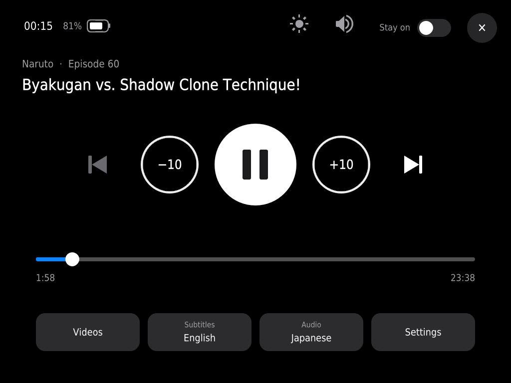
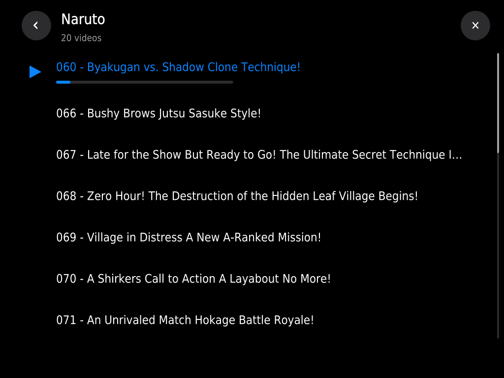
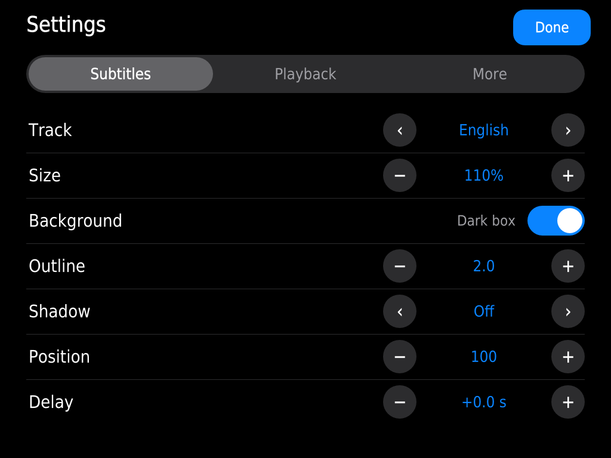
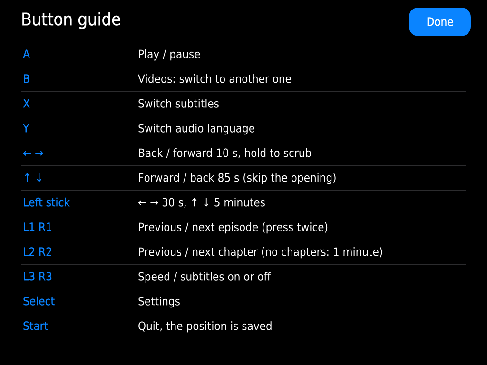

<h1>CMP</h1>

**Console Media Player: a music player and a video player for retro handhelds that you actually want to use.** 
Cover Flow, search, lyrics and radio for your music, chapters and a video browser for your series, made for a pad and for the second screen.

**[Download](https://github.com/cobanov/cmp/releases/latest)** · [Install](#try-it) · [Music](#music) · [Video](#video) · [Changes](CHANGELOG.md) · [Issues](https://github.com/cobanov/cmp/issues)

CMP replaces the music and video players that ship with handheld firmwares, which were never made for a small screen and a pad. It runs on [ROCKNIX](https://rocknix.org) today and is built on the mpv that ROCKNIX already includes, with Lua scripts and one small Python helper. There is nothing to compile. It fits any screen size, from 640x480 to the 1024x768 screens of the Anbernic RG DS Plus, and uses the second screen of dual-screen devices.

  
  
   Cover Flow on an Anbernic RG34XX SP (720x480), and the player with timed lyrics on a one-screen handheld.
    
  
  
   On an RG DS Plus (1024x768, two screens) the main screen shows the song, big, and the touch screen is the remote, with the queue.
    
  
  
   Search with the pad, and the settings: big type, made for a pad.
    
  
  
   Under a game the music carries on on the touch screen, with its own library and the lyrics.
    
  
  
   During a video the touch screen is the remote, and B opens the videos of the series to switch to another one.

## Music

- **Your library as it is.** Any folder with music is an album, at any depth: `Artist - Album`, `Artist/Album`, `Artist/Album/CD1`. Folders without a clear name are named from their tags, loose tracks become "Singles". Track names come from the tags. The library is kept between starts, so even a big one opens at once.
- **Covers without a computer.** Pictures come from `cover.jpg`, `folder.jpg` or the picture inside the track, are made on the device the first time and kept in a cache.
- **Search and a real queue.** Type with the pad to find any album or song. Play it next, add it to the queue, move or remove songs in the queue.
- **Cover Flow, a list, and a real player.** Browse with Cover Flow or a list, open an album, and the player shows the cover, the controls, the progress and what comes next. X switches the cover for the lyrics.
- **One meaning per button.** A chooses, B goes back, X jumps to the player, L1 R1 change the track, L2 R2 seek. The hints at the bottom always show the buttons in the same order.
- **Picks up where you left it.** The queue, the track and the position are saved when you quit.
- **In your pocket, lid shut.** While music plays, closing the lid, the power button or Screen off in the options turns the screen off and locks the buttons instead of putting the handheld to sleep. Open the lid, press power or hold Y to come back. When the music stops with the screen off, the handheld sleeps as usual. Pulling the headphones out pauses the music.
- **Lyrics, radio and audiobooks.** Timed lyrics from `.lrc` files follow the song, internet stations play from a simple `radio.m3u`, and long tracks remember where you stopped, with bookmarks and a speed control.
- **Sound your way.** A 10-band equalizer with presets, ReplayGain, crossfade between tracks, and the format, sample rate and bitrate of what is playing.
- **Sleep timer, clock and battery.** Stop the music after 15 to 90 minutes or at the end of the track, with a gentle fade. The clock and the battery (the same estimate EmulationStation shows) sit at the top of every page.
- **Two screens, two jobs.** On dual-screen devices the main screen shows what is playing, big: the cover or the lyrics. The touch screen is the remote: the controls, a progress bar to drag and the queue, where a tap plays a song; the pad picks in that queue too. Its speaker and sun set the volume and each screen's brightness (Sync keeps the two screens together), the clock and the battery sit in its top row, and a tap wakes it. L1 + R1 (or "Play in background") moves the music to the touch screen to keep playing, with its own library and the radio, while you play a game on the main screen.

### Music controls

| Button | What it does |
|---|---|
| A | Choose: open the album, play a track, press the focused control |
| B | Back |
| X | Now playing; there, the lyrics or the cover |
| Y | Options: play next, add to queue, search, screen off (hold Y to unlock a locked screen) |
| ↑ ↓ | Move; in Cover Flow, jump by letter; in the player, between the controls, the progress bar and the queue (two screens: pick a song in the queue on the touch screen) |
| ← → | Browse (hold to go faster); in the album list, jump by letter; in the player, walk the controls or seek (two screens: seek) |
| L1 R1 | Previous / next track |
| L1 + R1 | Play in the background (two screens) |
| L2 R2 | Back / forward 10 s |
| Select | Settings |
| Start | Play / pause |
| Select + Start | Quit, the queue is saved |
| Power, lid | While music plays: screen off and on |

## Video

- **Made for series.** L1 R1 go to the previous and next episode (press twice, so a stray shoulder does not throw away the one you watch), the next one starts by itself, and every video starts again where you stopped, with its subtitle and audio tracks.
- **Skip what you always skip.** L2 R2 jump between the chapters (the opening, the parts, the ending), ↑↓ move 85 s in files without them, the stick 30 s and 5 minutes. Hold ← → to scrub.
- **A video browser on B.** The folders and videos of your Media Player folder, the one playing marked, finished ones ticked and the ones left halfway with a bar. Pick another with the pad or, on two screens, with a finger.
- **Subtitles your way.** X switches the track and R3 hides them; their size, background, outline, shadow, position and delay are in the settings (Select), next to the audio track and the speed.
- **Two screens.** The touch screen is the remote: the episode, play and seek, the progress bar, the tracks, the volume and each screen's brightness, the clock and the battery. It turns off after a few seconds and a tap brings it back. L1 + R1 moves the video to the touch screen, so a game can run on the main one.

  
  
   The settings (Select) and the button guide, made for a pad like the rest.

### Video controls

| Button | What it does |
|---|---|
| A | Play / pause |
| B | Videos: switch to another one |
| X | Switch subtitles |
| Y | Switch the audio language |
| ← → | Back / forward 10 s, hold to scrub |
| ↑ ↓ | Forward / back 85 s (skip the opening) |
| Left stick | ← → 30 s, ↑ ↓ 5 minutes |
| L1 R1 | Previous / next episode (press twice) |
| L2 R2 | Previous / next chapter (no chapters: 1 minute) |
| L3 R3 | Speed / subtitles on or off |
| L1 + R1 | Watch on the touch screen (two screens) |
| Select | Settings |
| Start | Quit, the position is saved |

The video player is built and tested on the RG DS Plus; on a one-screen device the pad, the settings and the browser work over the video, without the touch remote.

## Try it

1. Put your music under `/storage/roms/music`, in any folder layout, and your videos under `/storage/roms/mplayer`, a folder per series if you like.
2. Download `cmp-<version>.tar.gz` from the [latest release](https://github.com/cobanov/cmp/releases/latest) and unpack it.
3. From a computer on the same network (SSH can be turned on in ROCKNIX's network settings; the root password is `rocknix` unless you changed it):
   - `./install.sh --music root@<handheld-ip>` for the music player alone, next to the stock one;
   - `./install.sh root@<handheld-ip>` for both: the video player then plays what Media Player opens.
4. In EmulationStation, open the Music Player system and start "Music", or a video in Media Player.

The music-only install goes to `/storage/.config/cmp`. To go back, delete that folder, `/storage/.config/gmu/playlists/Music.sh` and `/storage/.config/autostart/handheld-sway-fix`; for the full install also `/storage/.config/system.d/mpv.service.d` and `/storage/.config/mpv/scripts/handheld`.

## Want to tinker?

Lua scripts for mpv 0.41 with LuaJIT (`mpv/scripts/handheld`) and a Python 3 standard-library hub (`hub/media-hub.py`) that reads the pad, runs the second-screen windows and talks to sway. Covers and Cover Flow are drawn in LuaJIT FFI buffers; text is measured and drawn with libass. `tools/preview.sh` renders screens offscreen on a device. A distribution can ship the files in one folder and link `es/Music.sh` (and `es/Video.sh`, the video player, which takes the file to play) from anywhere: they find the rest next to themselves. Releases follow [semantic versioning](https://semver.org); every change is listed in [CHANGELOG.md](CHANGELOG.md) and `tools/release.sh` cuts a release.

---

GPL-2.0-or-later, like ROCKNIX. Not affiliated with the ROCKNIX project.
